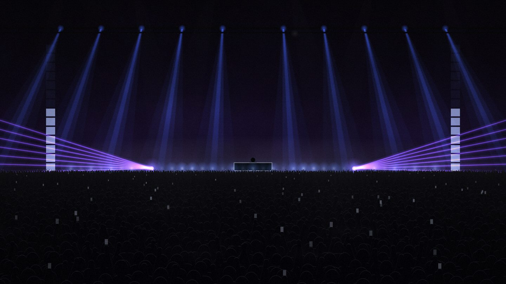
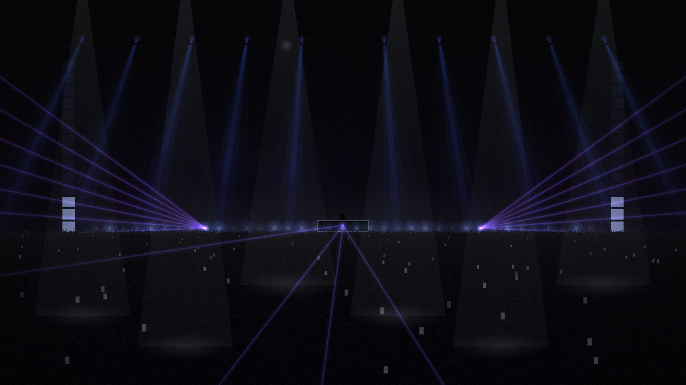
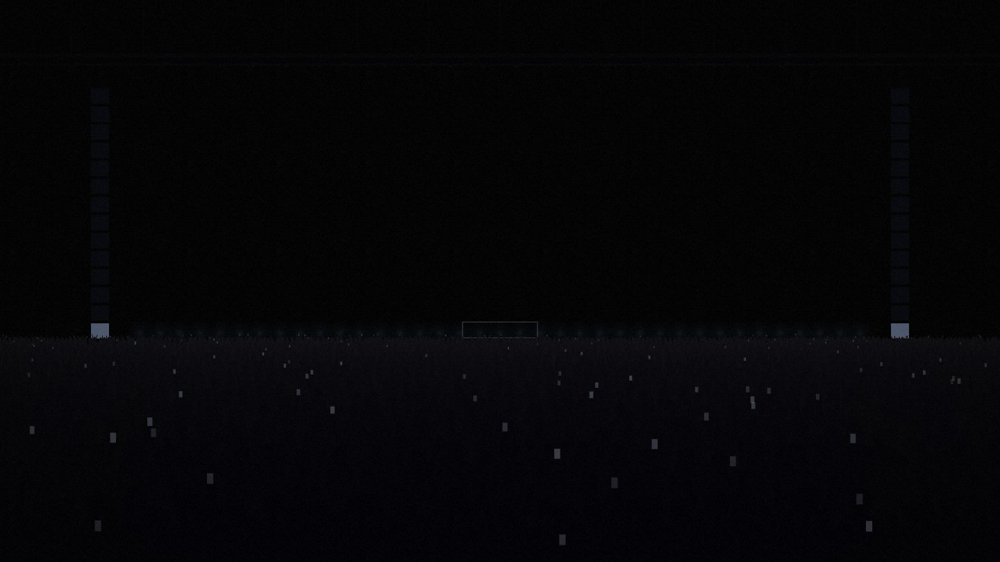
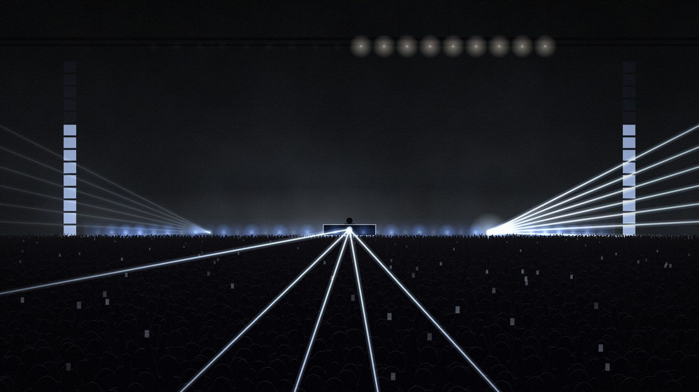

# Technolab

Müziği dinleyip ışıkları ritme göre süren, tarayıcıda çalışan bir techno arena sahnesi.
Kick vurur, sis duvarı parlar, lazerler döner; break'te sahne kararır, drop'ta her şey aynı anda patlar.

Next.js, Canvas 2D ve Web Audio API ile yapıldı. Çalışma zamanında harici bir görselleştirme kütüphanesi yok.

| Lazerlerle akış | Break (blackout) | Drop |
|---|---|---|
|  |  |  |

> Görüntüler, telif sorunu olmasın diye sentetik bir test parçasıyla alındı.

## Özellikler

- **Üç ses kaynağı:** sekme sesi (masaüstü), mikrofon, yerel dosya.
- **Katman katman tepki:** kick sis duvarını ve lazerleri, clap tepe spotlarını, hi-hat LED'leri, bas tavan hüzmelerinin kalınlığını sürer.
- **Bölüm algısı:** normal akış, break (blackout + build-up) ve drop ayrı davranır.
- **Ön analiz ("Dosya" modu):** şarkı çalmadan önce baştan sona taranır, ışıklar çalarken tahmin etmez, önceden çıkarılmış plandan okur.
- **YouTube hafızası:** link yapıştırılır, video YouTube'un gömülü oynatıcısından çalar. Şarkı ilk dinlenirken öğrenilen plan tarayıcıda saklanır, ikinci açılışta ışıklar şarkıyı önceden bilir. Sesin kendisi saklanmaz, sadece zaman bilgisi tutulur.
- **Geri bildirim:** hesap gerektirmeyen küçük bir form, `/mesajlar` sayfasında okunur.
- **Erişilebilirlik:** hızlı strobe varsayılan kapalı, `prefers-reduced-motion` ile hiç açılamaz.

## Nasıl çalışıyor

| Dosya | Görev |
|---|---|
| `src/lib/audio.ts` | Canlı analiz: bantlara ayırma, kick / hi-hat / clap algılama, plan modunda zaman okuma |
| `src/lib/tempo.ts` | Vuruş aralıklarından otokorelasyonla BPM, faz kilidi (PLL) |
| `src/lib/offline.ts` | Şarkının tamamını önceden analiz eder: vuruşlar, break'ler, drop'lar |
| `src/lib/memory.ts` | Canlı dinlerken olay kaydı, planı tarayıcıya kaydetme |
| `src/lib/arena/director.ts` | "Işık operatörü": bölümü okur, her ışığı kendi olayına bağlar |
| `src/lib/arena/scene.ts`, `crowd.ts` | Çizim: yarım çözünürlüklü hüzme tamponu, sis dokusu, kalabalık |
| `src/app/api/feedback/route.ts` | Geri bildirim ucu: bot tuzağı, hız sınırı, yetkili okuma |

Birkaç tasarım kararı:

- **Işık, tahmin edilen tempoya değil, duyulan kick'e bağlı.** Tahmini ızgaraya bağlayınca ışık duyulandan kayıyordu; doğrudan olaya bağlayınca düzeldi.
- **Ham dB verisi.** Tarayıcının bayt verisi yüksek seste tavana vurup değişimi gizliyordu, `getFloatFrequencyData` ile dB cinsinden çalışılıyor.
- **Gecikme ölçülüp telafi edildi.** Analiz penceresi, çizim karesi ve çıkış gecikmesi ayrı hesaplanıyor. Test parçasında ışık, gerçek kick'ten ortalama ~60 ms geç kalıyordu ve sapma ±60-80 ms'ydi; telafiden sonra ortalama gecikme ~0 ms, sapma ±12-22 ms oldu.
- **Rastgelelik sadece kurulumda.** Kalabalık ve ışık düzenleri tohumlu üretiliyor, çizim döngüsünde `Math.random` yok.

## Deneyim

- Açılışta sahne demo ritmiyle döner, kısa bir tanıtım ekranı çıkar.
- **Gir**'e basınca ışıklar kapanır; bir kaynak seçilene kadar sahne karanlıktır.
- Bir YouTube linki yapıştırılır ya da dosya seçilir. Müzik başlayınca ışıklar duyduğu her vuruşa tepki verir.
- Break'te sahne kararır, build-up'ta lambalar hızlanır, drop'ta tüm sahne birlikte patlar.
- Kontroller küçüktür ve birkaç saniye sonra kaybolur, ekranın büyük kısmını sahne kaplar.

## Bilinen sınırlar

- Testlerin çoğu sentetik parçalarla yapıldı, gerçek techno setlerinde tüm alt türler denenmedi.
- Sekme sesi mobilde yok.
- Geri bildirim formu, yayında yalnızca mesajları saklayacak depo bağlıysa görünür.
- YouTube oynatıcı ile uçtan uca davranış (reklam, ileri sarma) sınırlı test edildi.

## Müzik ve telif

Depodaki tek ses dosyası, "Örnek" butonu için kullanılan `public/samples/demo.mp3` (Sub_Clair — Hard Techno, Pixabay Content License). Başka müzik dosyası yok. YouTube videoları yalnızca resmî gömülü oynatıcıdan çalar, sitede barındırılmaz. Kullanıcının seçtiği dosyalar bilgisayarından çıkmaz, tarayıcıda analiz edilir.

## Geliştirme

Tasarım kararları, test ve yönlendirme bana ait; kodun büyük bölümü Claude (Anthropic) ile birlikte yazıldı.

## Lisans

Telif hakkı © 2026 whyasaf. Tüm hakları saklıdır. Kod yalnızca incelemek için herkese açıktır, izinsiz kopyalanamaz, değiştirilemez ya da kullanılamaz. Ayrıntı için [LICENSE](LICENSE) dosyasına bak.
